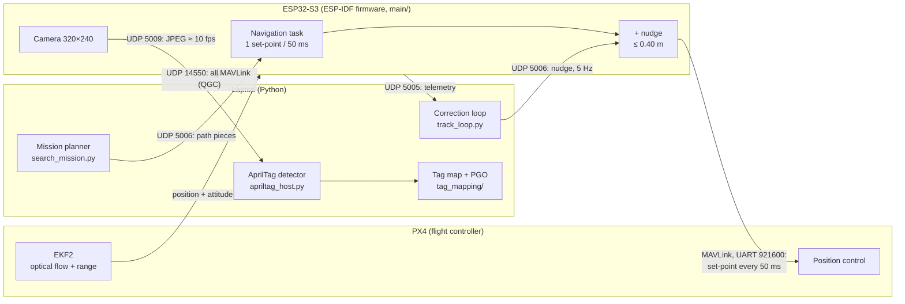

# CDE1302 UAV — Autonomous AprilTag Search

An indoor drone that searches a 3.6 × 3.15 m area for three target AprilTags, maps them,
and lands back in a 0.9 m box. It has no GPS. A laptop plans the path and measures the tags.
An ESP32-S3 on the drone relays the path and the camera. PX4 flies.

- **Search:** one fixed "lanes" path with smooth turn arcs, the nose pointing along the path.
- **Detection:** tag16h5 AprilTags, strict quality gate, pose from the 4 corners (IPPE) with
  a calibrated camera.
- **Correction loop:** the laptop compares the PX4 position with the path and sends small
  offsets ("nudges") at 5 Hz, a PI controller around PX4.
- **Landing:** home tag 23 has a known position. Seeing it gives the PX4 drift, which is
  removed before the landing (read twice: at 0.8 m and at 0.30 m).
- **Map:** after landing, a pose-graph optimisation (Gauss–Newton, LSMR, Huber loss) fits all
  drone poses and tag positions to every corner pixel seen.

Results from two runs on the final path (F17, F18): 3/3 targets and 4/4 known tags found in
each run. The tag positions after optimisation agree between runs to 0.10 m or better,
against 0.40–0.63 m before optimisation.

---

## System overview



| Link | Port | Data |
|---|---|---|
| ESP32 → PX4 | MAVLink, UART 921 600 baud | `SET_POSITION_TARGET_LOCAL_NED` every 50 ms, `HEARTBEAT` 1 Hz, `COMMAND_LONG` |
| PX4 → ESP32 | MAVLink, UART 921 600 baud | `LOCAL_POSITION_NED`, `ATTITUDE`, `ATTITUDE_QUATERNION`, `HEARTBEAT` |
| ESP32 → laptop | UDP 5005 | Telemetry: position, velocity, attitude, PX4 link state |
| Laptop → ESP32 | UDP 5006 | Commands: path data, path start, nudge, camera keep-alive, land |
| ESP32 → laptop | UDP 5009 | Camera JPEG frames, 320 × 240, about 10 fps |
| ESP32 ↔ laptop / QGC | UDP 14550 (ESP32 side 8888) | All PX4 MAVLink, forwarded (logs, parameters) |

---

## Repository layout

```
main/                      ESP32-S3 firmware (navigation, MAVLink bridge, Wi-Fi, camera)
components/                In-tree libraries: MAVLink c_library_v2, esp-apriltag, VL53L5CX
managed_components/        ESP-IDF managed components (committed so the build is offline)
sdkconfig.example          Firmware config template -- copy to sdkconfig (see below)
flash_drone.sh             Build + flash one drone with its ID and IP pinned
tools/idf-pin.env          Pinned ESP-IDF version
camera_intrinsics.json     Camera calibration (fx 183.3, fy 182.9, distortion)
calibration_images/        ChArUco photos used for the calibration
laptop/
  run_baseline.py          Main entry point: observe / fly / search mission
  search_mission.py        The search path (lanes, turn arcs, landing look point)
  apriltag_host.py         AprilTag detector (same C code as the firmware) + IPPE pose
  calibrate_camera.py      Camera calibration from ChArUco photos
  miniproject/             Pipeline: config.yaml, track_loop.py, tag_pipeline.py,
                           recorder.py, flight_guard.py, fake_drone.py (simulator), ...
  optimization_comparison/ Pose-graph optimisation (tag_mapping/) + before/after tool
  tests/                   pytest unit tests
docs/                      Original ESP32 bridge setup guide, QGC bridge notes
trajectory/, waypoints/    Example trajectories and waypoint files
```

---

## 1. Firmware (ESP32-S3)

You need [ESP-IDF](https://github.com/espressif/esp-idf) at the version pinned in
`tools/idf-pin.env`. Everything else is in the repository.

```bash
git clone https://github.com/espressif/esp-idf.git ../esp-idf
cd ../esp-idf && git checkout "$(sed -n 's/^IDF_CHECKOUT_REF=//p' ../cde1302-uav/tools/idf-pin.env)"
git submodule update --init --recursive
./install.sh esp32s3
cd -
```

### Configure your Wi-Fi (credentials are not in the repo)

`sdkconfig` holds the Wi-Fi name and password, so it is **not committed**. Make your own copy
from the template:

```bash
cp sdkconfig.example sdkconfig
```

Then set your network, either by editing these lines in `sdkconfig`:

```
CONFIG_WIFI_SSID="your-wifi-ssid"
CONFIG_WIFI_PASSWORD="your-wifi-password"
```

or with `idf.py menuconfig` → *Drone Configuration*. Your `sdkconfig` stays local
(it is in `.gitignore`). Never commit it.

### Build and flash

```bash
./flash_drone.sh 5 /dev/ttyUSB0      # drone ID 5 on that serial port
```

`flash_drone.sh` pins the drone ID and IP addresses for the build, flashes, and restores
`sdkconfig` afterwards. The addresses follow the drone ID:

```
drone (ESP32) IP = 192.168.1.(200 + ID)
laptop IP        = 192.168.1.(100 + ID)      # telemetry is sent here
```

Without the script: `idf.py set-target esp32s3 && idf.py -p <port> flash monitor`.
See [docs/ESP32_BRIDGE_SETUP.md](docs/ESP32_BRIDGE_SETUP.md) for the full firmware guide.

---

## 2. Laptop setup

Python 3.10 or later:

```bash
python3 -m pip install -r laptop/requirements.txt
python3 -m pip install pymavlink        # optional: logs PX4 MAVLink during flights
```

The AprilTag detector is built from the in-tree C sources the first time it runs
(needs a C compiler: `cc`/`gcc` on Linux and macOS, MinGW-w64 `gcc` on Windows).

Connect the laptop to the same Wi-Fi as the drone. The laptop should hold the address
`192.168.1.(100 + ID)` (or pass the drone's IP with `--esp-ip` on a phone hotspot).

### Try it without a drone (simulator)

```bash
python3 laptop/miniproject/fake_drone.py          # terminal 1: a fake drone on localhost
python3 laptop/run_baseline.py --drone-id 5 --esp-ip 127.0.0.1 --mode observe   # terminal 2
```

### Unit tests

```bash
python3 -m pytest laptop/tests
```

---

## 3. Running the mission

Run from the `laptop/` folder. Close QGroundControl's link to the drone first, or keep it in
observe-only use.

1. **Link check** (optional):
   ```bash
   python3 check_px4_esp32_link.py --drone-id 5          # expect RESULT: PASS
   ```
2. **Bench check, propellers off** — logs every tag with its estimated position:
   ```bash
   python3 run_baseline.py --drone-id 5 --esp-ip 192.168.1.205 --mode observe --show
   ```
3. **Search mission:**
   ```bash
   python3 run_baseline.py --drone-id 5 --esp-ip 192.168.1.205 --mode fly --mission search \
       --height 0.8 --search-retries 0 --show --label F19
   ```
   The script asks you to type `TRAJ-<id>` (here `TRAJ-5`) before take-off. It then flies the search path,
   corrects the drift with home tag 23, lands, and runs the pose-graph optimisation.

Each run writes a folder under `laptop/logs/` with `events.jsonl`, `observations.csv`
(every detection and why it was accepted or rejected), `summary.json`, the optimisation
results and plots. `--record-video` also saves the annotated camera view.

### Before / after optimisation on a recorded run

```bash
cd laptop/optimization_comparison
python3 -m pip install -r requirements.txt
python3 laptop/run_optimization_comparison.py
```

### Re-calibrate the camera

```bash
python3 laptop/calibrate_camera.py --images calibration_images --debug-dir calibration_detections
```

This writes `camera_intrinsics.json`, which the detector loads automatically
(set `APRILTAG_INTRINSICS=firmware` to use the old firmware values instead).

---

## 4. Key parameters

All in `laptop/miniproject/config.yaml` unless noted.

| Parameter | Value | Why |
|---|---|---|
| Flight height | 0.8 m | Tags readable up to 1.4 m with the camera pitched 45° |
| Path speed | 0.15 m/s | Enough frames per tag; less PX4 drift |
| Nose turn rate | 8°/s | No yaw overshoot at sharp turns |
| Turn arc radius | 0.12 m | One smooth turn, one direction |
| Bit errors allowed | 0 targets / 1 known tags | tag16h5 has only 30 codes; stops false IDs |
| Decision margin | > 55 (> 35 with 0 errors) | Clear codes only |
| Max range | 1.4 m (1.8 m if margin ≥ 100) | Far tags give poor poses |
| Correction loop | kp 0.3, ki 0.35 s⁻¹, ≤ 0.35 m, lag 0.4 s, 5 Hz | Removes the steady 0.2–0.3 m tracking offset |
| Low look height | 0.30 m | Close, sharp view of tag 23 before landing |
| PGO pixel noise | σ 0.7 px, Huber δ 1.345 | From calibration; down-weights outliers |

Known tags in the final field: home **23** at (0.75, 0), anchors **28** at (4, 0),
**1** at (2, 1) and **7** at (2, −1) — metres from the pad, x ahead, y right.

---

## 5. Limitations

- PX4 position comes from optical flow; it overestimates distance by about 1.1–1.25×, and
  this PX4 version has no flow-scale parameter. The correction loop, the home-tag check and
  the PGO reduce the effect.
- A box over a tag disturbs the range sensor (height jump and auto-descent).
- Without a sight of tag 23 the drone lands on the PX4 position only (error 0.2–0.4 m).
- During flight the live tag positions use yaw only; the PGO uses full roll, pitch and yaw.

---

## Acknowledgements

Built on the CDE1302 `esp-everything-qgc-bridge` course firmware (ESP32-S3 companion computer
and MAVLink bridge). Uses [AprilTag](https://april.eecs.umich.edu/software/apriltag),
[MAVLink](https://mavlink.io), [PX4](https://px4.io) and OpenCV.
